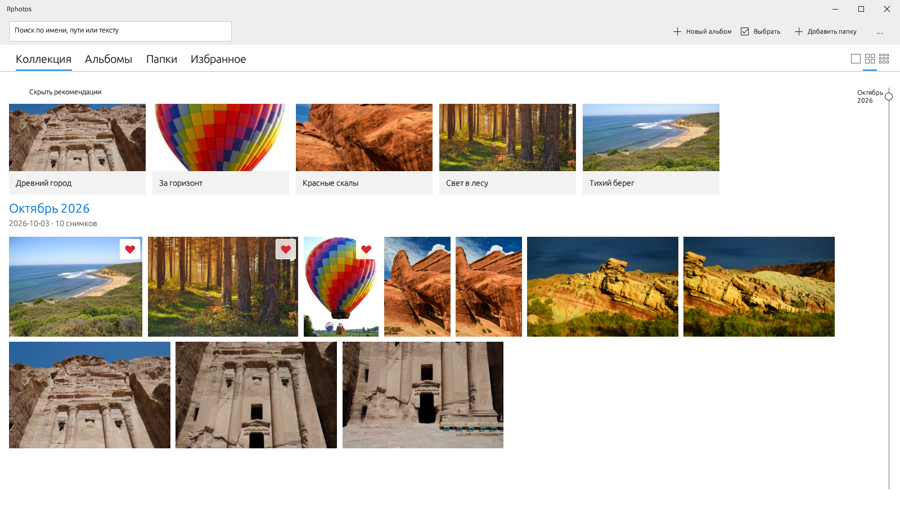
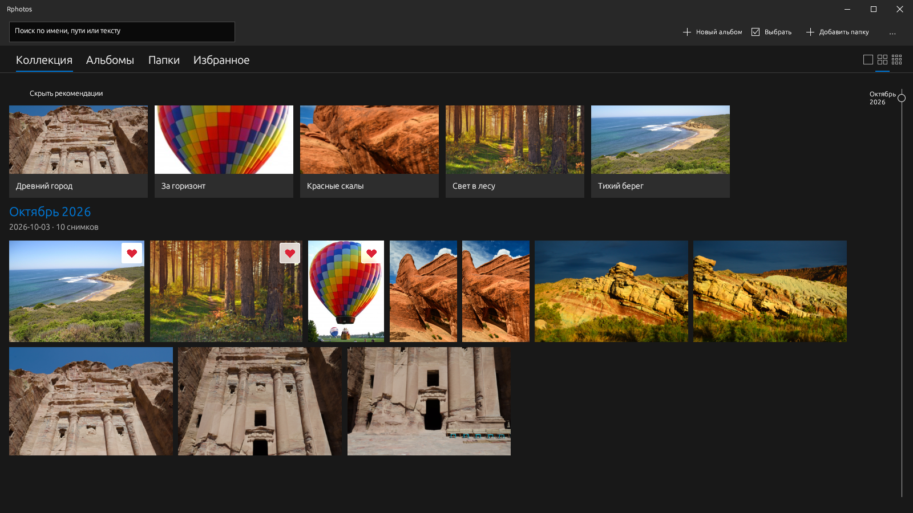
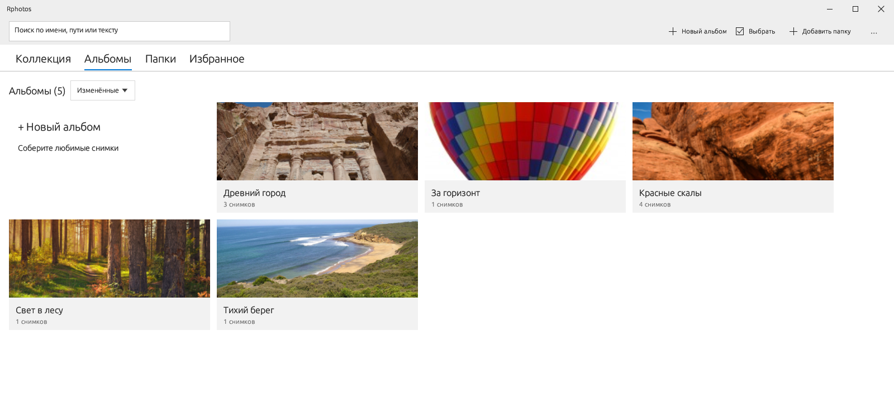
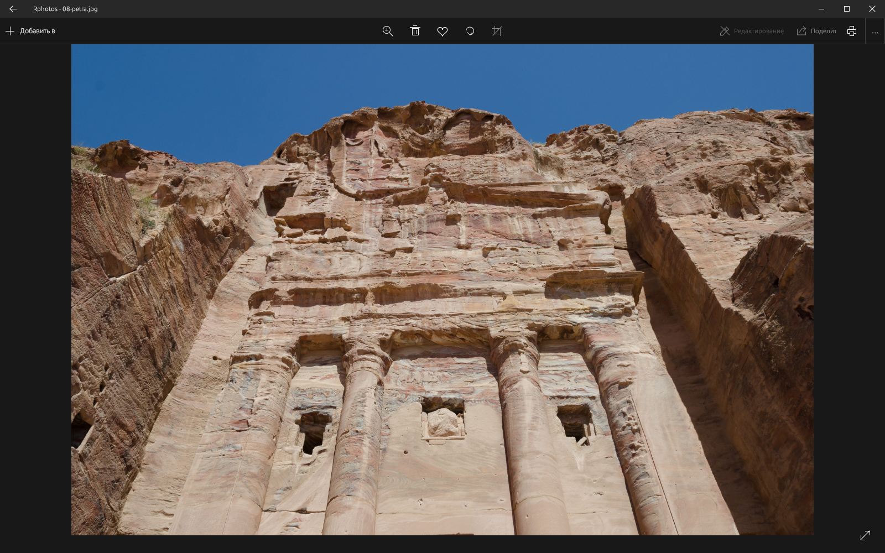
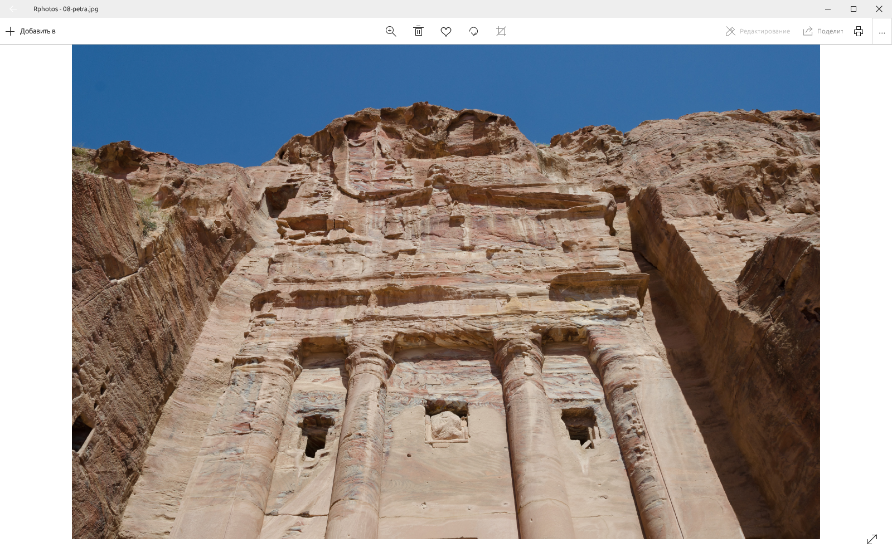

# Rphotos

Кроссплатформенный локальный просмотрщик и фотобиблиотека на Rust.
Основа — [ViewSkater](https://github.com/ggand0/viewskater), референс интерфейса —
Photos 2019. Приоритет: Linux, затем Windows и macOS.

[](https://github.com/DurkaEbanaya/Rphotos/actions/workflows/ci.yml)

[Скачать Development Preview 2 — Linux / Windows / macOS](https://github.com/DurkaEbanaya/Rphotos/releases/tag/v0.1.0-dev.2).
Это предварительная сборка, не stable release; сначала прочтите [ограничения](docs/PREVIEW.md).



Актуальный интерфейс приложения с демонстрационной фотобиблиотекой — настоящий
GPU-render, не макет. [Авторы фотографий и лицензии](docs/screenshots/README.md).
Размытие системного фона и качество распознавания здесь не демонстрируются.

<details>
<summary>Ещё скриншоты: тёмная тема, альбомы и просмотрщик</summary>

### Коллекция · тёмная тема


### Альбомы


### Просмотр фотографии · тёмная тема


### Просмотр фотографии · светлая тема


</details>

## Текущий статус

Библиотека использует ширину окна с небольшими16px отступами, без больших
центрирующих полей. Разделитель между заголовком окна и командами убран.
Окно ошибок кеша переносит длинные пути/причины и подстраивает высоту под записи.

Ошибки полной прогрузки доступны по клику на строку «Готово с ошибками» или
через `… → Ошибки кеша миниатюр`: имя, путь и причина, с локальным отчётом
`last-build-errors.json` в каталоге кеша. При быстрой прокрутке результаты текущего
экрана получают приоритет перед предзагрузкой; disk cache всё равно нужно
прочитать, декодировать и загрузить в GPU, поэтому произвольный скачок не является
гарантированно мгновенным.

### Масштаб и быстрая предзагрузка

В галерее `Ctrl+колесо` и двухпальцевый pinch плавно меняют размер снимков
(64–640 логических px по высоте строки). Три кнопки плотности остаются быстрыми
пресетами; повторный клик возвращает точный размер пресета. Размер сохраняется
после окончания жеста, без записи настроек на каждом кадре.

Миниатюры обрабатываются параллельно: в автоматическом режиме число CPU-потоков
минус один, максимум16; **Настройки → Предзагрузка миниатюр** позволяют выбрать
0 (авто) либо1–24. Видимый экран приоритетен; до восьми экранов по направлению
прокрутки и трёх с обратной стороны готовятся заранее. Спекулятивная очередь
заменяется при смене viewport, не накапливает всю библиотеку. Лимиты:2048 queued jobs,
64 ready results; GPU cache сохраняет до2048 недавно использованных миниатюр,
мягкий бюджет512MiB (visible/prefetch защищены), hard guard4096 textures.
Дисковый кеш по умолчанию16ГиБ, настраивается вплоть до «без ограничения».
Непрерывный scroll не вызывает reflow из-за прихода миниатюр.
Оригиналы >48MP/>64MiB или неизвестного размера декодируются последовательно,
чтобы не умножать пиковую память. HDD иногда быстрее с меньшим числом потоков;
скорость ограничена носителем, форматом и размером файлов — мгновенная загрузка
всей библиотеки не обещается. Предзагрузка не запускает OCR/ML.

**«… → Прогрузить все миниатюры»** в главном меню заранее
строит постоянный кеш всей проиндексированной библиотеки, а не только текущего
поиска/альбома. Есть прогресс, счётчик ошибок, пауза и остановка; видимые фото
обрабатываются первыми. Повторный запуск использует готовые превью; после закрытия
приложения задача сама не возобновляется, но готовые файлы остаются. Для полного
кеша лимит автоматически переключается в0 — без ограничения. Можно вернуть
конечный лимит в настройках после завершения задачи. Каталог кеша показан там же;
лучше размещать его на SSD (стандартный XDG cache на Linux). Если кеш тоже на HDD,
дисковое чтение остаётся, но читаются маленькие превью, а не тяжёлые оригиналы.
Полноразмерное открытие всё ещё использует оригинал; кеш400px его не заменяет.
Не запускается автоматически: нажмите кнопку сами, учитывая свободное место.
Статус — плоская панель48px с локальной тонкой линией прогресса и line icons
паузы/остановки. После окончания её можно закрыть; в настройках только параметры,
без дублирующей кнопки запуска.

Возле маркера шкалы постоянно видны текущий месяц и год, без наведения мыши.
Минимальный бегунок64px остаётся удобным и на очень длинной коллекции.
Сканирование сначала считает файлы, затем показывает обработано/всего и процент.
Итог соответствует обходу доступных папок; файлы, изменившиеся во время scan,
могут изменить его. Предварительный подсчёт добавляет один обход каталогов.

Начальная стадия разработки, **не готовый интерфейс Photos 2019**.
Унаследованы просмотр, декодирование, кеширование, навигация и сравнение снимков
из ViewSkater. Имя приложения и каталоги настроек отделены от оригинала.
У приложения собственный значок; SVG и воспроизводимый генератор находятся в репозитории.
Общее оформление нажатий: прозрачные кнопки, акцент при удержании, Reveal-подсветка
под курсором и световой контур клавиатурного фокуса; отметки выбора/избранного сохраняются.

Первый рабочий сценарий библиотеки:

- добавление папок, рекурсивный фоновый индекс SQLite, обновление и отмена;
- native watcher источников: изменения объединяются перед фоновым пересканированием;
- Коллекция по месяцам даты съёмки (fallback — дата файла), виртуализированные строки трёх плотностей;
- миниатюры по запросу с дисковым кешем и ограниченным GPU-кешем;
- поиск по имени/пути, распознанному тексту и локальным описаниям; сохранённые запросы;
- opt-in смысловой поиск по embeddings описаний и автоальбомы похожего содержимого;
- карточки настоящих альбомов в Коллекции, скрытие рекомендаций и подсказки поиска;
- избранное в локальном индексе: отдельная вкладка после «Папки», сердце при наведении;
- плитки альбомов, создание через выбор снимков, переименование, обложка,
  добавление/исключение снимков и удаление альбома **без удаления оригиналов**;
- Папки: источники и вложенные каталоги, отдельно файлы текущей папки;
  удаление источника **без удаления файлов**;
- открытие выбранного снимка в просмотрщике без синхронного декодирования;
- возврат кнопкой «Назад» в заголовке или Esc; раздел, фильтр и scroll сохраняются
  между нормальными закрытиями приложения;
- RU/EN и светлая/тёмная/системная тема библиотеки и одиночного просмотра.

Одиночный просмотр теперь использует отдельную Photos-подобную сцену:
клиентский заголовок 32 px, панель команд 48 px, локальный zoom-popup,
сведения слева шириной 344 px, боковые зоны перехода,
кнопка fullscreen снизу справа. Постоянные меню File/View, footer и слайдер
навигации остаются только в расширенном режиме сравнения.
Работают стрелки клавиатуры, колесо над фото, Ctrl+колесо, Home/End, I, F11,
слайд-шоу, добавление в альбом и удаление в корзину с подтверждением.
Меню `…` также сохраняет точную копию исходного файла (включая metadata),
копирует файл в clipboard и вызывает «Открыть с помощью» (Linux portal,
Windows OpenWith dialog, macOS application chooser). Копия сохраняется только
под новым именем. В Resize есть отдельная команда **«Сохранить и перезаписать
оригинал»** («Сохранить с перезаписью»), с дополнительным подтверждением, без диалога нового имени.
Перед заменой создаётся постоянная recovery-копия: Undo доступен после повторного
открытия/перезапуска, пока файл не изменён другой программой. Это один последний
шаг на путь, не безлимитная история. Recovery хранится в local data/rphotos/recovery-v1;
автоматическая очистка не выполняется. JPEG/PNG,128MiB edit safety limit; resize
перекодирует пиксели и удаляет metadata, о чём предупреждает диалог.
На Unix сохраняются ownership/mode/xattrs, на Windows используется ReplaceFile;
при ошибке переноса атрибутов операция прерывается. Последняя проверка содержимого
не является атомарным compare-and-swap против внешнего редактора.
Есть базовый touch-свайп при вписанном фото и pan при увеличении;
проверены синтетические события, не реальный сенсорный экран.

Шапка библиотеки теперь имеет фиксированные command/tab-панели по 48 px,
поиск слева и графические переключатели плотности справа. Выделение заменяет
обычные команды тёмной панелью; поддерживаются выбор группы и добавление в альбом.
В узком окне дополнительные команды доступны через `…`, без переноса панели.

Галерея раскладывает снимки в строки с учётом пропорций, без подписей под фото.
Нажатие на заголовок месяца открывает список месяцев; выбор возвращает к группе.
Справа в широком окне — шкала времени с кликом и перетаскиванием.
При уточнении пропорций и смене плотности сохраняется привязка к видимому фото.
Вычисленные пропорции сохраняются в SQLite: знакомые миниатюры не требуют
повторного уточнения после перезапуска.

Добавлены полностраничные настройки, уведомления альбомов, контекстные меню,
пакетная корзина с подтверждением и touch-свайп между разделами: две соседние
страницы следуют за пальцем, затем доводятся до границы. Автотесты проверяют
блокировку случайных нажатий, vertical escape и отсутствие зацикливания tabs;
поведение на настоящем touchscreen ещё требует приёмки.
Дисковые превью — сжатые PNG до400px, сохраняются между запусками. Исходник
проверяется в background: если он недоступен/изменился, фотография полностью скрыта
из сетки, выбора для альбома и списка открытия — без ячейки «Файл недоступен». Кеш
не удаляется и не считается decode error. Уже видимые файлы перепроверяются
примерно каждые2с; доступность может измениться между проверками.
Квота по умолчанию16GiB,0=unlimited; полная прогрузка выбирает unlimited.
Превью без обращений90дней удаляются даже без квоты; при превышении квоты
чистятся самые старые, кроме использованных за последние7дней (мягкий лимит).
ПКМ по фотографии → «Показать в проводнике»: выделение через FileManager1/Explorer/
Finder, либо доступная родительская папка, если оригинал отсутствует.
Scan/OCR можно отменять и ставить на паузу между снимками/пакетами.

Это пока не точная копия Photos: алгоритм строк приблизительный.
Шапка использует настоящий compositor blur на Wayland с
`ext-background-effect-v1` или KDE blur protocol; на неподдерживаемой системе
и без фокуса используется непрозрачный фон. Клиентский заголовок остаётся своим.
Windows/macOS получили native blur/vibrancy adapters через window-vibrancy;
прозрачна только шапка, остальная поверхность непрозрачна. Эти новые adapters
ещё требуют проверки на настоящем дисплее каждой ОС; неподдерживаемые системы
остаются непрозрачными. На некоторых Windows builds API blur замедляет resize.
Поворот JPEG/PNG вправо/влево и отражение сохраняются без перекодирования пикселей:
меняется только EXIF-ориентация, остальные сегменты/чанки остаются прежними.
Кнопка поворота — в верхней панели, отражение/поворот влево/отмена — в `…`.
`Ctrl+R` — вправо, `Ctrl+Shift+R` — влево, `Ctrl+Z` — отменить последнюю трансформацию.
На macOS используется Cmd. Отмена одноуровневая; постоянная recovery-запись
переживает закрытие просмотрщика и приложения.
Запись фоновая: staged file проверяется декодером, оригинал повторно сверяется,
затем атомарно заменяется; при внешнем изменении операция/отмена отказываются от записи.
Поворот пока только для обычных JPEG/статических PNG до128MiB; RAW/анимации, symlinks,
hard links и read-only файлы не изменяются. PNG-просмотрщики без поддержки EXIF могут
игнорировать сохранённый поворот. Обрезка и цветовые коррекции пока отключены.
В меню просмотрщика также есть «Показать в проводнике»; избранное отмечается красным сердцем,
как и в коллекции.
«Изменить размер…» сохраняет новую PNG/JPEG-копию с заданными шириной/высотой,
пропорциями, пресетами100/50/25% и качеством JPEG10–100. Ориентация применяется
к пикселям; EXIF/ICC и прочие метаданные в копию не переносятся. Прозрачность JPEG
заменяется белым. Лимиты16384px по стороне и48MP; copy-команда не заменяет файлы,
отдельная overwrite-команда заменяет только текущий оригинал после подтверждения.
Для RAW/анимаций экспортируется декодированное превью/первый кадр, не весь контейнер.
Расширенный режим сравнения
и его настройки пока используют английское upstream-меню.
Индекс загружается при старте и обновляется в фоне. Native watcher отслеживает
источники, объединяет изменения за800мс и запускает scan после текущей задачи.
F5 остаётся ручным fallback для недоступных источников/ограничений OS watcher.
Хронология и автоальбомы событий используют EXIF-дату съёмки, если она доступна,
иначе дату изменения файла. EXIF читается фоновым сканером без декодирования
пикселей, с пределом4MiB; неподдержанные контейнеры и metadata за этим пределом
используют fallback. Пустые вложенные папки также сохраняются в индексе.
Полная приёмка на сенсорном устройстве, Windows/macOS blur/print/share,
проверка качества смыслового поиска и точное воспроизведение всех переходов ещё остаются.

### Печать и локальный анализ

- **Linux Print:** системный XDG Print portal, PDF формируется после подтверждения.
  Подключение скомпилировано; отправка на реальный принтер пока не проверена.
- **Windows/macOS Print:** добавлены native WPF/PDFKit printer dialogs, печать только
  после подтверждения. Требуется platform-native проверка; default printer молча не используется.
- **Поделиться:** собственный диалог Rphotos с отдельной кнопкой системного chooser
  на Windows/macOS (DataTransferManager / NSSharingServicePicker).
  Экспорт PDF, копирование файлов и Linux `xdg-email` с вложениями в черновике.
  Автоматической отправки нет. Linux file clipboard: `wl-copy` из `wl-clipboard`
  либо X11/XWayland `xclip` с `text/uri-list`. Адаптеры Windows/macOS добавлены,
  но на этих ОС пока не проверены. «Копировать путь» остаётся отдельным действием.
- **Качество просмотра:** fit8192 + native viewport tiles для100% больших изображений;
  embedded RGB ICC → sRGB через LittleCMS. Monitor ICC и CMYK end-to-end не готовы.
  RAW без embedded JPEG пробует установленный LibRaw shared library (не скачивается,
  не включён в архив). Качество проверено пока на synthetic Bayer DNG, не камерах.
- **Автоальбомы:** явная команда в настройках группирует минимум 3 снимка
  по датам съёмки с fallback на дату файла, с разрывом до двух дней; отдельная команда группирует
  похожие embeddings текстовых описаний. Ручные и отредактированные автоальбомы
  не удаляются при пересборке. Категории/личности людей не определяются.
- **OCR:** необязательный установленный Tesseract (`rus`/`eng`), один поток CPU,
  45 секунд на фото. Ничего не устанавливается автоматически.
- **Содержимое:** необязательный уже установленный vision-модель Ollama.
  Укажите её имя в настройках и явно запустите анализ; уменьшенные копии идут
   только на `127.0.0.1:11434` через `curl`, без proxy и без скачивания моделей.
   Перед передачей данных `/api/show` должен подтвердить capability модели;
   облачные aliases и `remote_host`/`remote_model` отклоняются. Нужен локальный
   Ollama с metadata capabilities; доверять произвольному локальному proxy нельзя.
   Описания RU/EN индексируются как текст; качество описания зависит от модели.
   OCR и реальная модель на этой машине
   пока не проверены; проверены адаптеры, mock-сервер и сохранение индекса.
- **Смысловой поиск:** укажите уже установленную embedding-модель Ollama
  (например, multilingual `bge-m3`), затем «Построить смысловой индекс».
  Требуется предварительный OCR или описание содержимого. Введите запрос и
  выберите `… → Смысловой поиск по этому запросу`. Текст отправляется только
  на фиксированный localhost, не фотографии; моделей приложение не скачивает.
  До 100 совпадений с cosine ≥0.3, отображение по датам; изменение запроса
  возвращает обычный поиск. «Очистить смысловой индекс» позволяет перестроить
  его после замены модели с тем же именем. В памяти векторы ограничены256MiB.
  Автоальбомы: сходство с представителем ≥0.75, ≥3 фото, максимум64 группы и
  10000 фото. Это similarity текстовых описаний, не прямые image embeddings.
  Проверены нормализация, ранжирование, invalidation, loopback adapter и
  сохранность альбомов; качество настоящей модели ещё не проверено.
Требования и этапы: [docs/PRODUCT.md](docs/PRODUCT.md).
Наблюдения по референсу: [docs/PHOTOS-2019.md](docs/PHOTOS-2019.md).
Измеренный аудит: [docs/PHOTOS-2019-AUDIT.md](docs/PHOTOS-2019-AUDIT.md).
Карта продолжения разработки: [docs/IMPLEMENTATION.md](docs/IMPLEMENTATION.md).
Проверки и ограничения: [docs/VERIFICATION.md](docs/VERIFICATION.md).

## Как попробовать

Запустите без аргументов, нажмите «Добавить папку» и дождитесь индексации.
Щелчок по миниатюре открывает фото; «Выбрать» или Ctrl+щелчок включает выделение.
«Новый альбом» открывает страницу выбора фотографий; пополнение доступно
из альбома и через «Добавить в» при выделении.
Настройки языка и темы находятся в меню `…`.

Клавиатура библиотеки: F5 — обновить, Ctrl+O — выбрать папку,
Ctrl+1/2/3/4 — Коллекция/Альбомы/Папки/Избранное, Ctrl+A — выделить отфильтрованные фото,
Esc — выйти из фильтра альбома/папки и выделения. На macOS вместо Ctrl — Cmd.
Поле поиска защищено от горячих клавиш просмотрщика.
В сетке: стрелки — переход между снимками/строками, Home/End — первый/последний
с автопрокруткой, Enter — открыть, Space — выделить, Shift+стрелки — расширить
выделение. Обрабатываются и снимки вне видимой виртуализированной области;
горячие клавиши не перехватывают ввод в поле поиска и кнопки toolbar.

## Сборка

```sh
cargo run --release
cargo run --release -- /path/to/photo.jpg
RUST_LOG=rphotos=debug cargo run
cargo test
```

Сборка использует upstream-форки `winit` и `egui-winit`, закреплённые в
`Cargo.lock`. Первой сборке нужен доступ к crates.io и GitHub.

Локальный portable-архив (без установки/публикации):

```sh
cargo build --locked --release
python3 scripts/package.py
```

Архив и SHA-256 появятся в `dist/`. Это development build, не подписанный
installer/AppImage/macOS `.app`. CI настроен собирать и прикладывать такие
артефакты для трёх OS. Remote CI для `d089114` прошёл на Linux x86_64,
Windows x64 и macOS ARM64: tests, all-features check, optimized build и упаковка.
Это не заменяет ручную приёмку native UI/печати/touch на каждой ОС.
Оригинал значка — `assets/rphotos.svg`; PNG/ICO/ICNS воспроизводятся командой
`python3 scripts/generate-icons.py` (необязательная build-tool зависимость Pillow).

Для локальной интеграции с меню Linux после сборки:

```sh
install -Dm755 target/release/rphotos ~/.local/bin/rphotos
install -Dm644 assets/rphotos.desktop ~/.local/share/applications/rphotos.desktop
install -Dm644 assets/rphotos.png ~/.local/share/icons/hicolor/256x256/apps/rphotos.png
```

Репозиторий проекта: [DurkaEbanaya/Rphotos](https://github.com/DurkaEbanaya/Rphotos).
Development artifacts в GitHub Actions не являются стабильным релизом;
ссылки на релизы ViewSkater не являются загрузками Rphotos.
Перед запуском предварительной сборки: [docs/PREVIEW.md](docs/PREVIEW.md).

## Происхождение и лицензии

База: ViewSkater, commit `6ab9bf73ba5443e0cf76e8c78b184d1268da99fc`.
История Git и авторство сохранены. Код распространяется по MIT OR Apache-2.0:
[LICENSE-MIT](LICENSE-MIT), [LICENSE-APACHE](LICENSE-APACHE).
[Исходный README](docs/UPSTREAM-README.md) сохранён отдельно.

Скриншоты с личного устройства и пользовательские фотографии в репозиторий
и релизные архивы не включаются. Ресурсы Microsoft из референса не копируются.
